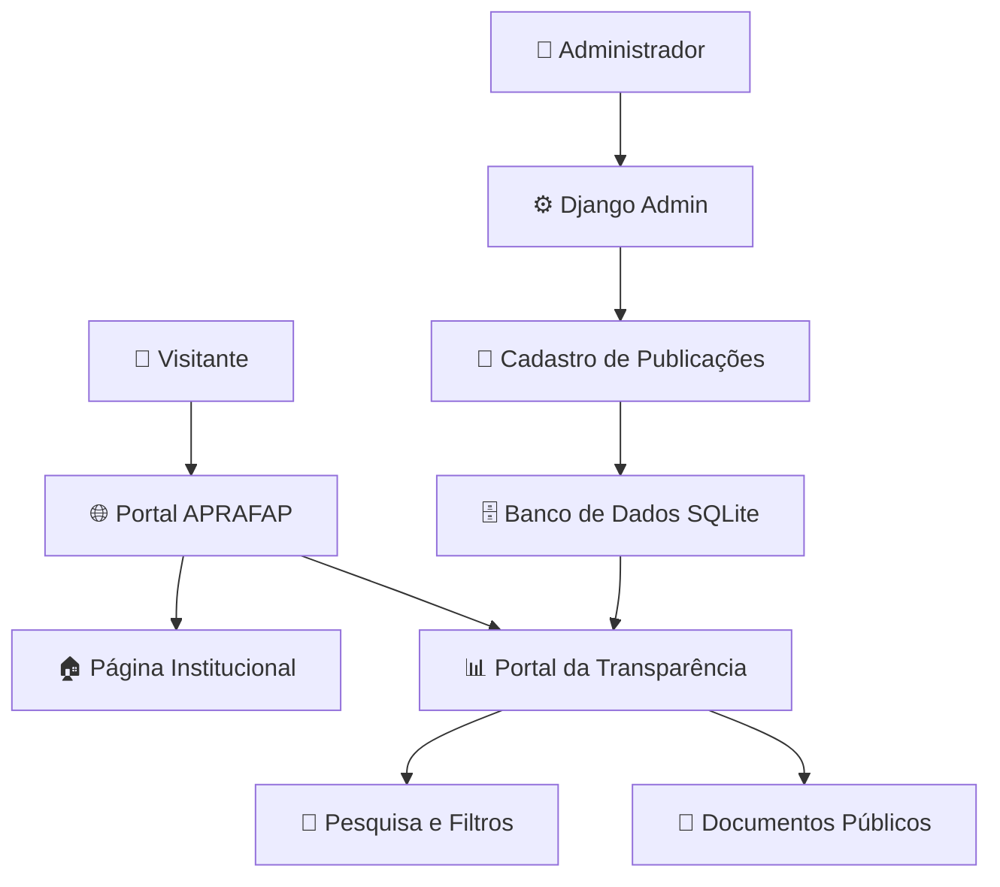

# 🌱 APRAFAP — Portal Institucional e Portal da Transparência
<p align="center">
  
</p>

<div align="center">

  <h2>🚜 APRAFAP</h2>
  <p><strong>Associação dos Produtores Rurais e Agricultores Familiares de Picuí</strong></p>
  <p>🌵 Picuí – Paraíba | Brasil 🇧🇷</p>

  
  
  
  
  
  

</div>

---

## 📖 Sobre o Projeto

O **APRAFAP** é um sistema web institucional desenvolvido para a Associação dos Produtores Rurais e Agricultores Familiares de Picuí – PB.

O projeto tem como finalidade apresentar informações institucionais da associação e disponibilizar um **Portal da Transparência**, destinado à divulgação de informações concernentes à prestação de contas de recursos financeiros, maquinários agrícolas, implementos e equipamentos recebidos do Governo do Estado da Paraíba.

O portal busca contribuir para a transparência, organização documental e acesso público às informações da associação, considerando a Lei Federal nº 13.019/2014 e a Lei Estadual nº 12.869/2023.

## 🎯 Objetivos do Sistema

- 🌱 Valorizar a agricultura familiar e os produtores rurais.
- 📢 Divulgar informações institucionais da APRAFAP.
- 💰 Disponibilizar informações sobre recursos financeiros recebidos.
- 🚜 Divulgar maquinários agrícolas, implementos e equipamentos.
- 📄 Facilitar o acesso aos documentos de prestação de contas.
- 🔎 Permitir consultas públicas às informações divulgadas.
- 🔐 Disponibilizar um painel administrativo para gerenciamento das publicações.

## ✨ Funcionalidades

### 🏠 1. Página Institucional (`/`)

- Apresentação da associação.
- História, missão e objetivos.
- Informações sobre agricultura familiar.
- Divulgação de atividades e projetos.
- Identidade visual institucional.

### 📊 2. Portal da Transparência (`/transparencia/`)

- Listagem de publicações oficiais.
- Consulta de recursos financeiros.
- Divulgação de maquinários agrícolas.
- Relação de implementos e equipamentos.
- Filtro por categoria.
- Pesquisa por título ou palavra-chave.
- Exibição de órgão responsável, data de recebimento e valor, quando aplicável.
- Download de documentos comprobatórios.

### ⚙️ 3. Painel Administrativo (`/admin/`)

- Cadastro de publicações.
- Edição e gerenciamento de informações.
- Organização por categorias.
- Upload de documentos.
- Controle de publicações.
- Gerenciamento pelo Django Admin.

## 🖥️ Demonstração Visual do Sistema

O portal está organizado nas seguintes áreas:

| Área | Descrição |
|---|---|
| 🏠 Início | Apresentação institucional |
| 🌱 Associação | História e informações institucionais |
| 💰 Recursos | Informações financeiras |
| 🚜 Maquinários | Máquinas agrícolas recebidas |
| 🔧 Equipamentos | Implementos e equipamentos |
| 📄 Transparência | Relatórios e documentos |
| ⚙️ Administração | Gerenciamento das publicações |

## 🛠️ Tecnologias Utilizadas

<div align="center">

| Tecnologia | Aplicação |
|---|---|
| 🐍 Python | Linguagem principal |
| 🎸 Django | Framework Back-end |
| 🌐 HTML5 | Estrutura das páginas |
| 🎨 CSS3 | Estilização |
| 💨 Tailwind CSS | Interface e responsividade |
| ⚡ JavaScript | Interatividade |
| 🗄️ SQLite | Banco de dados |
| 📦 uv | Gerenciamento de dependências |
| 💻 VS Code | Ambiente de desenvolvimento |

</div>

## 🏗️ Arquitetura do Sistema



## 📁 Estrutura do Projeto

```text
aprafap/
│
├── config/
│   ├── settings.py
│   ├── urls.py
│   ├── asgi.py
│   └── wsgi.py
│
├── institucional/
│   ├── migrations/
│   ├── static/
│   │   └── institucional/
│   │       ├── css/
│   │       └── js/
│   │
│   ├── templates/
│   │   └── institucional/
│   │       ├── home.html
│   │       └── transparencia.html
│   │
│   ├── admin.py
│   ├── apps.py
│   ├── models.py
│   ├── urls.py
│   └── views.py
│
├── manage.py
├── pyproject.toml
├── uv.lock
└── README.md
```

## 🚀 Como executar o projeto localmente

### 1. Clonar o repositório

```bash
git clone https://github.com/Marcosplira/aprafap.git
```

Entre na pasta:

```bash
cd aprafap
```

### 2. Instalar as dependências

Utilizando o gerenciador `uv`:

```bash
uv sync
```

### 3. Aplicar as migrações

```bash
uv run python manage.py migrate
```

### 4. Criar um superusuário

```bash
uv run python manage.py createsuperuser
```

### 5. Iniciar o servidor

```bash
uv run python manage.py runserver
```

### 6. Acessar o sistema

| Ambiente | Endereço |
|---|---|
| 🏠 Site institucional | http://127.0.0.1:8000/ |
| 📊 Transparência | http://127.0.0.1:8000/transparencia/ |
| 🔐 Administração | http://127.0.0.1:8000/admin/ |

## ⚖️ Fundamentação Legal

O projeto considera como referências normativas:

- **Lei Federal nº 13.019/2014:** estabelece o regime jurídico das parcerias entre a administração pública e as organizações da sociedade civil.
- **Lei Estadual nº 12.869/2023:** legislação estadual indicada para orientar as obrigações relacionadas à transparência e divulgação das informações.

A aplicação das exigências legais deve ser observada conforme a natureza dos recursos, instrumentos e obrigações aplicáveis à associação.

## 🌵 Impacto Social

O portal pretende contribuir para:

- 🤝 Fortalecimento da associação.
- 🌱 Valorização dos agricultores familiares.
- 🚜 Divulgação dos bens recebidos.
- 📊 Transparência na utilização dos recursos.
- 📄 Organização dos documentos institucionais.
- 🌎 Acesso público às informações.

## 👨‍💻 Desenvolvimento

Projeto desenvolvido para a **APRAFAP – Associação dos Produtores Rurais e Agricultores Familiares de Picuí**, município de Picuí, Paraíba.

**Tecnologias:** Python, Django, JavaScript, HTML5, CSS3 e Tailwind CSS.

## 📄 Licença

Este projeto foi desenvolvido para fins institucionais da APRAFAP – Picuí/PB.

---

<div align="center">

  🌱 **APRAFAP — Fortalecendo a agricultura familiar!**

  🚜 Agricultura, transparência e desenvolvimento rural.

  **Picuí – Paraíba 🇧🇷**

</div>
